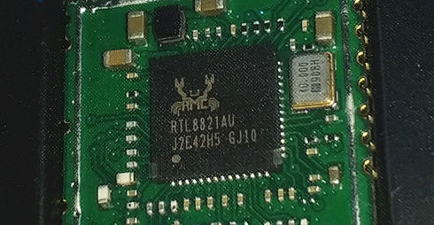

# rtw88-openwrt 🚀
Package and tools for the latest [Linux rtw88](https://github.com/lwfinger/rtw88) driver, backported for OpenWrt 23.05, 24.10, and 25.12.

With this repo, you can build ready-to-use modules with the latest fixes for your router. You can test patches from rtw88 devs too :)



## Support
- RTL8812AU
- RTL8814AU
- RTL8821AU
- RTL8821CU
- RTL8822BU
- RTL8822CU
- RTL8723DU

## Thanks
Thanks to henkv1 for the original repo: https://github.com/henkv1/rtw88-usb-openwrt/

## How to Use

### Build rtw88 for the official OpenWrt-provided 25.12 binaries
This is the most common case.

- Boot your favorite Linux distro and install the prerequisites: https://openwrt.org/docs/guide-developer/toolchain/install-buildsystem
- Download the SDK for your device. For example: if you have a Filogic router with 25.12.4, you can download the openwrt-sdk-25.12.4 tarball from https://downloads.openwrt.org/releases/25.12.4/targets/mediatek/filogic/
- Uncompress and go to the new folder.
- Update the package feeds: `./scripts/feeds update -a ; ./scripts/feeds install -a` (see: https://openwrt.org/docs/guide-developer/toolchain/using_the_sdk for information on using the SDK)
- Clone this repository into the folder package/kernel/rtw88-backports: `git clone https://github.com/LuisMitaHL/rtw88-openwrt package/kernel/rtw88-backports`.
- Run make defconfig.
- There are three compat patches, one per OpenWrt version: `999-openwrt-23.05-compat.patch`, `999-openwrt-24.10-compat.patch` and `999-openwrt-25.12-compat.patch`. **Keep only the one matching your OpenWrt version and delete the other two.** They must stay last (hence the `999` prefix): they rewrite the kernel-version checks on top of the backported rtw88 patches.
- Compile the package: `make package/rtw88-backports/compile`. You can add ` -j$(nproc)` at the end for multi-core compiling.

If the build process works, you will find two files:
- The firmware package is named rtw88-backports-firmware-*.apk and you can find it in the bin/packages/{architecture}/base/ directory. 
- The kernel module package is named kmod-rtw88-backports-usb_*.apk and you can find it in the bin/targets/{architecture}/{model}/packages/ directory.

You can copy both packages to your device and install them one by one using `apk add {package} --allow-untrusted`. Install the firmware package first.

### Build the patch

rtw88 is not directly compatible with OpenWrt. This is because OpenWrt uses a hybrid codebase (for example, 23.05 uses Linux 5.15 with mac80211 backports from 6.1), and kernel version checks by rtw88 must be modified with a patch.

The `patches` folder holds two kinds of patches, applied in filename order:

- `0xxx-*.patch` — upstream rtw88 fixes backported from `pkshih/rtw` `rtw-next`, one file per upstream commit. They apply to the raw lwfinger tree and are shared by every OpenWrt version.
- `999-openwrt-<version>-compat.patch` — the per-version rewrite of the `LINUX_VERSION_CODE` checks. Keep only the one matching your OpenWrt version, and keep it last: it is generated on top of the `0xxx-*.patch` files.

You can generate your own compat patch if the rtw88 repo has been updated, or you want to test or revert some code and the provided patch does not work anymore.

This only works for OpenWrt 23.05, 24.10, and 25.12 target devices.

- Clone the original rtw88 repo.
- Apply every `0xxx-*.patch` from this repo's `patches` folder to the rtw88 tree, in filename order (do **not** apply the `999-openwrt-*.patch` yet), then stage the result with `git add -A`.
- From this repo, choose a script from `tools` for your OpenWrt version and execute it inside the rtw88 tree.
- Generate the compat patch with `git diff > 999-openwrt-<version>-compat.patch` inside the rtw88 tree. Because the backports are already staged, only the script's changes end up in the diff.
- Put the file in the "patches" folder of a local copy of this repo.

## Tips & Tricks

### My USB adapter is disconnecting too frequently (STA mode)

Some adapters are a bit deaf (8812au looking at you 👀). This behavior is worse when the adapter is heavily used. You can mitigate that by adding this to `/etc/modules.conf`:
```
options mac80211 max_nullfunc_tries=20 max_probe_tries=50 beacon_loss_count=70 probe_wait_ms=5000
```

